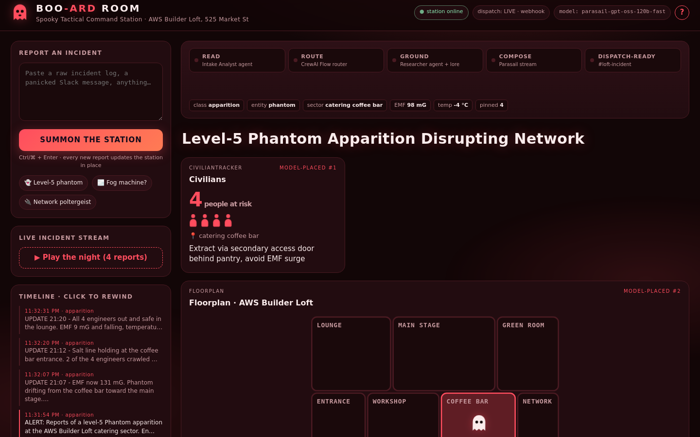
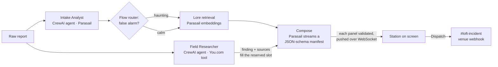

# 👻 Boo-ard Room

**A command station that designs its own interface out of a messy incident report.**

Track 2, *The Haunted Dashboard* · Hack with YOU: Halloween Edition · You.com × One · AWS Builder Loft, San Francisco · October 28, 2026 · built solo by `a1slv`

Paste a panicked report: *"4 engineers are pinned behind the coffee bar, EMF 98 milligauss and climbing, temperature −4 °C."* Boo-ard Room reads it, works out what is happening and where, has an agent check the readings against the real web, and **lays out the screen an operator needs**: which panels appear, in what order, with what values, and even the colour theme. Panels stream onto the screen as the model writes them. Every new report reshapes the station in place, and a Dispatch button posts the alert to the venue's `#loft-incident` channel.

Nothing on screen is a template. The page only knows how to draw each kind of panel; the model decides everything else.

## Demo



**[▶ Watch the 2:45 demo](docs/demo.mp4)** (captioned, no audio): the event's own incident streaming in, hover explanations, the agent's reality check with real sources, dispatch, a four-report night updating in place, a fog-machine false alarm and a network haunting. Recorded on October 28 against a dry-run copy of the station, so nothing was posted.

## Quick start

Needs Python 3.10–3.13.

```bash
cp .env.example .env    # add YDC_API_KEY, PARASAIL_API_KEY, TEAM_HANDLE, DISCORD_WEBHOOK_URL
./run.sh                # creates .venv, installs requirements, serves http://localhost:8666
```

Then click **👻 Level-5 phantom** (the event's own fixture), **🌫️ Fog machine?** (a false alarm) or **▶ Play the night** (four reports in a row). Hover anything for an explanation, or press `?` for a 30-second guide.

**No keys, no network?** Open `web/index.html` directly in a browser. It shows a real recorded night (`web/snapshot.js`), with the full timeline to rewind through.

## How it works



One CrewAI **Flow** (`app/pipeline.py`) runs each report:

1. **Read.** The **Intake Analyst** agent turns the raw text into typed `IncidentFacts`. It runs on two Parasail models at once and keeps the first valid answer, because the shared engines swing between fast and slow. Plain gauge readings such as "98 milligauss" are also parsed by code (`app/instruments.py`), which fills any gap the model left.
2. **Research, in parallel.** The **Field Researcher** agent starts from the raw report at the same moment. It decides its own You.com searches (at most two, 20-second limit) and states the most plausible mundane explanation.
3. **Route.** A `@router` sends false alarms down a calm path and hauntings down an investigation path.
4. **Retrieve.** Parasail embeddings (`parasail-bge-m3`) rank the 12 counter-measures in `data/lore.json`. Keyword overlap takes over if the embeddings engine is busy.
5. **Compose.** Parasail streams the layout against a JSON schema of 10 component types. A small scanner (`app/stream_parse.py`) pulls each complete component out of the half-written JSON, so it reaches the browser while the next is still being written. If the research isn't back yet, the model reserves a RealityCheck slot, and the Researcher's finding and sources fill it when they land.
6. **Act.** The operator picks a counter-measure and presses Dispatch; the line is posted to `#loft-incident`.

On the event's fixture: facts in about 1.5 s, first panels after 2.5–10 s, and the full station in about 12 s, depending on how busy the shared models are.

## Partners, and why each is load-bearing

| Partner | Role here | Remove it and… |
|---|---|---|
| **Parasail** | Both agents' models, lore embeddings, and the streamed, schema-locked layout | nothing gets built |
| **You.com** | The Field Researcher's search tool (`POST ydc-index.io/v1/search`); its results are the only sources the RealityCheck may cite | the station invents its explanations |
| **CrewAI** | The Flow (`@start` → `@router` → parallel gather → compose) and the two agents with their own roles, tools and typed outputs | no routing, no agent-led research; a fog machine gets the full panic interface |
| **Discord webhook** | The Dispatch button posts to `#loft-incident`, the venue's escalation channel, always prefixed with the team handle | the station can look, but not act |

The organizers replaced One with the venue's Discord webhook for dispatch on October 28, after One's Discord send started returning 401 even on fully authorized connections. The webhook URL lives only in `.env`.

## Guardrails

Every streamed panel is checked in `app/parasail.py` before it reaches the screen:

| Check | Stops |
|---|---|
| Schema validation per component | missing or wrong-typed props |
| One of each component type | duplicate panels |
| RealityCheck URLs must be ones You.com returned | invented citations |
| Counter-measures must come from retrieved lore | invented counter-measures |
| Channel fixed to `#loft-incident`, team handle prefixed | posts to the wrong place, or posts no one can attribute |

The brief's sample manifest is never shown to the model, so it can't be echoed back.

## Project structure

| Path | What it does |
|---|---|
| `run.sh` | One command: venv, install, serve on port 8666 |
| `app/server.py` | FastAPI app: the page, `/api/status`, `/api/night`, the `/ws` WebSocket; start-up warm-up |
| `app/pipeline.py` | The CrewAI Flow for one report |
| `app/agents.py` | The Intake Analyst and Field Researcher, model racing, retries and fallbacks |
| `app/parasail.py` | Streaming composition, prompts, guardrails, the RealityCheck fill |
| `app/stream_parse.py` | Pulls finished components out of a JSON stream |
| `app/models.py` | Facts, the 10 component types, the manifest |
| `app/instruments.py` · `app/lore.py` · `app/grounding.py` · `app/dispatch.py` | Gauge parsing · lore retrieval · You.com client · webhook dispatch |
| `web/index.html` | The whole UI in one file: no external fonts or libraries |
| `web/snapshot.js` | A recorded night, shown offline |
| `data/lore.json` · `data/night.json` | Counter-measure library · presets and the four-report night |
| `tests/` | Streaming parser, guardrails, agents' fallbacks, dispatch (11 tests) |

## Configuration

All settings come from `.env` (see `.env.example`; it is gitignored):

| Variable | Purpose |
|---|---|
| `YDC_API_KEY` | You.com search |
| `PARASAIL_API_KEY` | Every model call |
| `PARASAIL_*_MODEL` | Compose, extract, fallback and embedding models |
| `TEAM_HANDLE` | Self-chosen handle; every post starts with it |
| `DISCORD_WEBHOOK_URL` | The venue webhook from the event page; never commit it |
| `DISPATCH_MODE` | `dry` shows alerts in the UI, `live` posts them |

## Development

```bash
.venv/bin/python -m pytest          # 11 tests, no keys needed
.venv/bin/pip install ruff && .venv/bin/ruff check app tests && .venv/bin/ruff format --check app tests
```

## Beyond ghosts

Every on-call team turns free-text alerts into decisions under pressure. Swap the lore library for runbooks and the component catalog for service maps, and the same pipeline builds an outage war room, a security triage board or a building evacuation board.

## License

MIT, see [LICENSE](LICENSE).
